# AI Study Assistant – Tài liệu Phân tích & Thiết kế Hệ thống

Phiên bản 1.0 · Dựa trên Project Specification v1 · Ngày 24/11/2026

## 1. Giới thiệu

### 1.1 Mục đích và phạm vi

Tài liệu mô tả phân tích và thiết kế hệ thống **AI Study Assistant**: ứng dụng Desktop (Electron + React/TypeScript) gọi Backend REST/WebSocket (Java Spring Boot, MySQL), hỗ trợ chu trình học tập *Organize → Understand → Practice → Evaluate → Improve* và mở rộng sang lớp học, bài tập, lịch, chat, thông báo.

Tài liệu gồm: đặc tả yêu cầu, actor, chức năng, API contract, API endpoints, use case, activity diagram, sequence diagram và ERD.

### 1.2 Các quyết định đã chốt (từ mục Open Decisions)

| Mã | Quyết định | Ảnh hưởng thiết kế |
| :--- | :--- | :--- |
| D-01 | Sinh viên gửi yêu cầu bằng mã lớp, giảng viên duyệt mới thành viên | Bảng `class_join_request` , trạng thái PENDING/APPROVED/REJECTED |
| D-02 | Bài trắc nghiệm và bài nộp file chỉ nộp **một lần** mặc định | Unique constraint (bài, sinh viên); cho phép giảng viên mở lại nộp |
| D-03 | Thông báo gửi cả trong ứng dụng và email | Outbox có kênh IN_APP và EMAIL |
| D-04 | Import lịch hỗ trợ .ics và CSV theo mẫu | Hai bộ parser, bước xem trước và xác nhận trùng giờ |
| D-05 | Chỉ có ứng dụng Desktop, không có Web Portal | Giảng viên dùng cùng ứng dụng, menu theo vai trò |
| D-06 | Google Calendar **chỉ đọc** , không ghi ngược | OAuth scope chỉ đọc; task cá nhân chỉ lưu trong hệ thống |
| D-07 | Phạm vi áp dụng: Học viện Kỹ thuật Mật mã | Cần chính sách dữ liệu, tài khoản tổ chức |

### 1.3 Điểm mâu thuẫn trong đặc tả và cách xử lý

Mục 13.4 nói tạo link Meet qua Google Calendar API (cần quyền ghi), nhưng mục 23 chốt Google Calendar chỉ đọc. Tài liệu này theo **mục 23**: giảng viên **dán link Meet thủ công** khi tạo sự kiện; Google Calendar chỉ dùng để đọc/đồng bộ lịch vào ứng dụng. Việc tạo Meet tự động được đánh dấu *tùy chọn, cần quyết định lại* (xem mục 3.6).

### 1.4 Thuật ngữ

| Thuật ngữ | Ý nghĩa |
| :--- | :--- |
| Chunk | Đoạn văn bản nhỏ được cắt từ tài liệu để gửi AI |
| RAG | Truy xuất các đoạn liên quan rồi mới hỏi AI, kèm nguồn |
| Job AI | Tác vụ AI chạy bất đồng bộ, có trạng thái |
| Outbox | Bảng sự kiện ghi cùng transaction để worker gửi sau |
| Idempotency key | Khóa chống thực hiện lặp khi client gửi lại |

## 2. Actor

| Actor | Loại | Mô tả và quyền chính |
| :--- | :--- | :--- |
| Student (Sinh viên) | Chính | Quản lý khóa học/tài liệu cá nhân, học với AI, làm quiz, tham gia lớp, nộp bài, xem lịch, chat, lập kế hoạch |
| Teacher (Giảng viên) | Chính | Tạo/quản lý lớp, duyệt thành viên, đăng tài liệu, giao bài, tạo bài kiểm tra, chấm điểm, tạo sự kiện, theo dõi lớp. Chỉ quản lý lớp mình được phân quyền |
| Administrator (Quản trị viên) | Chính | Quản lý tài khoản, vai trò, lớp, báo cáo, cấu hình, hạn mức AI, cho phép tài khoản Google cá nhân |
| AI Provider (Gemini hoặc tương đương) | Hệ thống ngoài | Tóm tắt, giải thích, hỏi đáp, sinh quiz/flashcard/kế hoạch. Chỉ Backend gọi |
| Google Calendar API | Hệ thống ngoài | Cung cấp dữ liệu lịch (chỉ đọc) qua OAuth |
| Email Service (SMTP) | Hệ thống ngoài | Gửi thông báo email |
| File Processing Engine | Thành phần nội bộ | Trích xuất, chuẩn hóa, chia chunk PDF/DOCX/TXT (PDFBox, POI) |
| Notification Worker | Thành phần nội bộ | Đọc outbox, gửi thông báo, retry, chống trùng |
| Scheduler | Thành phần nội bộ | Kích hoạt nhắc hạn nộp, nhắc lịch theo mốc cấu hình |

Quan hệ vai trò: Teacher và Admin cũng có thể dùng chức năng học cá nhân của Student (tùy cấu hình).

## 3. Đặc tả yêu cầu

Ưu tiên: **M** = bắt buộc (MVP), **S** = nên có, **C** = có thể làm sau. Phase theo mục 22 của đặc tả.

### 3.1 Danh mục chức năng và use case

| FR | Module | Use case | Actor | Ưu tiên | Phase |
| :--- | :--- | :--- | :--- | :--- | :--- |
| FR-01 | Identity | UC-01 Đăng ký · UC-02 Đăng nhập · UC-03 Đăng xuất · UC-04 Xem/sửa hồ sơ · UC-05 Đổi mật khẩu | Mọi vai trò | M | 1 |
| FR-02 | Course | UC-06 Quản lý khóa học · UC-07 Quản lý chương · UC-08 Quản lý chủ đề | Student | M | 1 |
| FR-03 | Material | UC-09 Tải tài liệu lên · UC-10 Xem/tải/xóa tài liệu · UC-11 Phân loại · UC-12 Trích xuất văn bản | Student | M | 1 |
| FR-04 | AI | UC-13 Tóm tắt tài liệu (ngắn/vừa/chi tiết) | Student | M | 1 |
| FR-05 | AI | UC-14 Giải thích khái niệm · UC-15 Hỏi đáp theo tài liệu có trích nguồn · UC-16 Xem lịch sử chat AI · UC-17 Báo câu trả lời sai | Student | M (15 ở phase 5) | 1, 5 |
| FR-06 | AI | UC-18 Tạo quiz bằng AI (số lượng, chủ đề, độ khó) | Student, Teacher | M | 1 |
| FR-07 | Quiz | UC-19 Làm quiz · UC-20 Nộp và tự chấm · UC-21 Xem giải thích · UC-22 Xem lịch sử kết quả | Student | M | 1 |
| FR-08 | Flashcard | UC-23 Tạo flashcard (tay/AI) · UC-24 Ôn tập, đánh giá mức nhớ | Student | S | 5 |
| FR-10 | Analytics | UC-25 Xem thống kê điểm, câu sai thường gặp, chủ đề nên ôn | Student | M | 1 |
| FR-11 | Permission | UC-26 Phân quyền theo vai trò · UC-27 Quản lý người dùng/vai trò | Admin | M | 2 |
| FR-12 | Classroom | UC-28 Tạo lớp · UC-29 Gửi yêu cầu vào lớp bằng mã · UC-30 Duyệt/từ chối · UC-31 Quản lý thành viên · UC-32 Bảng tin, ghim · UC-33 Đăng tài liệu lớp · UC-34 Rời lớp/gỡ thành viên | Teacher, Student | M | 2 |
| FR-13 | Assignment | UC-35 Tạo bài tập · UC-36 Nộp bài · UC-37 Chấm điểm, nhận xét, trả bài · UC-38 Xử lý nộp muộn | Teacher, Student | M | 2 |
| FR-14 | Test | UC-39 Tạo bài kiểm tra (thời gian, thời lượng, số lần, trộn câu) · UC-40 Làm bài kiểm tra | Teacher, Student | M | 2 |
| FR-15 | Meeting | UC-41 Tạo sự kiện học/kiểm tra/họp, lưu link Meet · UC-42 Hủy/đổi sự kiện | Teacher | S | 3 |
| FR-16 | Timetable | UC-43 Nhập .ics/CSV · UC-44 Xem lịch ngày/tuần/tháng · UC-45 Cảnh báo trùng lịch · UC-46 Đồng bộ Google Calendar (đọc) | Student | S | 3 |
| FR-17 | Plan | UC-47 Tạo mục tiêu · UC-48 Quản lý task theo ngày · UC-49 AI đề xuất lộ trình · UC-50 Chấp nhận/sửa/bỏ đề xuất | Student | S | 5 |
| FR-18 | Chat | UC-51 Chat 1-1 · UC-52 Chat nhóm lớp (tự tạo) · UC-53 Xem lịch sử (phân trang) | Student, Teacher | S | 4 |
| FR-19 | Notification | UC-54 Xem danh sách thông báo · UC-55 Đánh dấu đã đọc · UC-56 Cấu hình loại thông báo | Mọi vai trò | S | 4 |
| FR-20 | Dashboard | UC-57 Dashboard giảng viên | Teacher | M | 2 |
| FR-21 | Dashboard | UC-58 Dashboard sinh viên | Student | M | 1–2 |
| – | Admin | UC-59 Xử lý báo cáo · UC-60 Cấu hình hệ thống và hạn mức AI | Admin | C | 6 |

### 3.2 Đặc tả chi tiết các use case trọng tâm

**UC-13 Tóm tắt tài liệu**

- Tiền điều kiện: đã đăng nhập, tài liệu thuộc về người dùng, đã trích xuất văn bản (status = EXTRACTED).

- Luồng chính: chọn tài liệu → chọn độ dài → gửi yêu cầu → hệ thống tạo job AI → làm sạch, chia chunk, gọi LLM → kiểm tra đầu ra → lưu → hiển thị.

- Luồng thay thế: tài liệu chưa trích xuất (báo và đề nghị thử lại); tài liệu scan không có chữ (báo chưa hỗ trợ, OCR là tùy chọn); AI lỗi/timeout (retry có kiểm soát, rồi báo lỗi dễ hiểu).

- Hậu điều kiện: bản tóm tắt lưu cùng phiên bản prompt, model, tài liệu nguồn, thời điểm tạo.

**UC-15 Hỏi đáp theo tài liệu**

- Luồng chính: nhập câu hỏi → tìm đoạn liên quan → dựng prompt có ngữ cảnh → AI trả lời → hiển thị câu trả lời, tên tài liệu, trang/đoạn; tách phần *trong tài liệu* và phần *AI giải thích thêm*.

- Luồng thay thế: không tìm thấy thông tin → trả lời cố định “Tài liệu hiện tại chưa có thông tin để kết luận” và đề nghị bật chế độ tham khảo kiến thức ngoài.

- Phase 1 dùng chọn đoạn theo từ khóa/chương; phase 5 dùng embedding + vector store.

**UC-18 và UC-20 Quiz**

- Tạo: chọn tài liệu, số câu, chủ đề, độ khó → AI trả JSON → kiểm tra cấu trúc (đúng 1 đáp án với dạng một lựa chọn, đủ phương án, có giải thích) → lưu; JSON sai thì retry tối đa 2 lần.

- Nộp bài: Backend tự chấm bằng đáp án đã lưu, ghi điểm, thời gian làm, từng câu đúng/sai. Không tin điểm do client gửi.

**UC-28 → UC-30 Tham gia lớp**

- Giảng viên tạo lớp, hệ thống sinh mã lớp duy nhất. Sinh viên nhập mã → tạo yêu cầu PENDING → giảng viên duyệt → thành viên được thêm vào lớp và phòng chat lớp → phát thông báo.

- Một sinh viên chỉ có một yêu cầu PENDING cho mỗi lớp (unique constraint).

**UC-36 Nộp bài**

- Máy chủ quyết định đúng hạn/muộn bằng giờ máy chủ trong cùng transaction lưu bài. Mặc định một lần nộp (D-02). Dùng idempotency key để gửi lại không tạo bài trùng.

- Bài nộp muộn chỉ được chấp nhận khi bài cho phép nộp muộn, gắn nhãn LATE.

**UC-43 Nhập lịch**

- Tải .ics/CSV → phân tích → hiển thị bản xem trước, đánh dấu sự kiện trùng giờ → người dùng xác nhận → lưu cùng nguồn nhập, múi giờ, thời điểm cập nhật. Lịch lớp do giảng viên tạo là chỉ đọc với sinh viên.

### 3.3 Quy tắc nghiệp vụ

| Mã | Quy tắc |
| :--- | :--- |
| BR-01 | Mật khẩu băm (BCrypt/Argon2); khóa tạm tài khoản sau nhiều lần đăng nhập sai |
| BR-02 | Mọi thao tác kiểm tra quyền ở Backend; ẩn nút ở UI không phải bảo mật |
| BR-03 | Dữ liệu cá nhân (khóa học, tài liệu, quiz, chat AI) chỉ chủ sở hữu truy cập |
| BR-04 | Giảng viên chỉ quản lý lớp mình là chủ nhiệm hoặc đồng giảng dạy; sinh viên chỉ xem lớp mình là thành viên |
| BR-05 | Thành viên rời lớp hoặc bị gỡ thì mất quyền vào phòng chat và tài liệu lớp ngay |
| BR-06 | Giờ máy chủ quyết định hạn nộp và thời gian làm bài kiểm tra |
| BR-07 | Thông báo không gửi trùng: khóa duy nhất theo người nhận + loại sự kiện + đối tượng + mốc nhắc |
| BR-08 | AI chỉ nhận đoạn tài liệu cần thiết; không đưa tài liệu lớp này vào câu trả lời cho lớp khác |
| BR-09 | Kết quả AI lưu kèm phiên bản prompt, model, nguồn, thời điểm; quiz/flashcard phải qua kiểm tra cấu trúc |
| BR-10 | Google Calendar chỉ đọc; task và sự kiện cá nhân trong app không ghi ngược |
| BR-11 | AI đề xuất kế hoạch không tự ghi đè lịch cá nhân; người dùng phải chấp nhận |
| BR-12 | Không giữ transaction mở trong lúc gọi AI hoặc dịch vụ ngoài |
| BR-13 | Giới hạn loại file (PDF, DOCX, TXT), kích thước tối đa, tên file được làm sạch |

### 3.4 Yêu cầu phi chức năng

| Mã | Yêu cầu | Tiêu chí đo kiểm được |
| :--- | :--- | :--- |
| NFR-01 | Chạy trên Windows, Linux, macOS | Đóng gói bằng Electron, cài đặt thử trên cả 3 hệ điều hành |
| NFR-02 | Hiệu năng | CRUD thông thường phản hồi dưới 500 ms (p95); tác vụ AI bất đồng bộ, UI không treo; có loading, timeout (đề xuất 60 s), lỗi |
| NFR-03 | Bảo mật | Khóa AI chỉ ở Backend; JWT ngắn hạn + refresh token; HTTPS; kiểm tra file; refresh token Google được mã hóa |
| NFR-04 | Tin cậy | Retry có giới hạn và backoff; log có cấu trúc, không ghi mật khẩu/token/nội dung riêng tư; dữ liệu bền vững |
| NFR-05 | Bảo trì | Tách Controller–Service–Repository–DTO–Entity; module theo nghiệp vụ; API nhất quán |
| NFR-06 | Dễ dùng | Tiếng Việt phổ thông, có trạng thái tải/rỗng/lỗi/thành công, hỗ trợ bàn phím, màu không là cách duy nhất báo trạng thái |
| NFR-07 | Hiệu năng truy vấn | Không N+1; phân trang ở database; kiểm tra số query theo API |
| NFR-08 | Đồng thời | Unique constraint, optimistic locking (version), idempotency key; có test song song |
| NFR-09 | Real-time | WebSocket tự kết nối lại, tải bù qua REST, phân trang tin nhắn theo cursor |
| NFR-10 | Quyền riêng tư | Thông báo rõ dữ liệu gửi AI; chính sách lưu/xóa dữ liệu; Google OAuth tối thiểu quyền, cho phép ngắt kết nối |

### 3.5 Yêu cầu chất lượng AI (rút từ mục 15)

- Mặc định trả lời bằng tiếng Việt phổ thông, ngắn gọn, giải thích thuật ngữ bằng từ thông dụng.

- Bám sát tài liệu; không tự tạo số liệu, định nghĩa, trích dẫn, đáp án không có căn cứ.

- Hiển thị tên tài liệu và trang/đoạn; phân biệt nội dung tài liệu với phần AI suy luận.

- Có nút “Báo câu trả lời sai/không bám tài liệu”, có bộ câu hỏi kiểm thử mẫu.

- Phân tích tiến độ nêu lý do và mức độ chắc chắn, không gán nhãn năng lực người học.

### 3.6 Phạm vi theo phase và hạng mục cần quyết định lại

- **Phase 1 (MVP):** FR-01 đến FR-07, FR-10, FR-21 (bản cơ bản), đóng gói Desktop.

- **Phase 2:** FR-11 đến FR-14, FR-20, một luồng end-to-end lớp học → bài tập → nộp/chấm.

- **Phase 3:** FR-15, FR-16. **Phase 4:** FR-18, FR-19. **Phase 5:** FR-08, FR-17, RAG. **Phase 6:** tối ưu, kiểm thử tải, CI/CD.

- **Cần quyết định lại:** (1) tạo Meet tự động có cần quyền ghi Google Calendar hay không; (2) quy mô người dùng để chọn có dùng Redis Pub/Sub; (3) OCR cho tài liệu scan; (4) kích thước file tối đa và hạn mức AI mỗi người dùng.

## 4. API Contract

### 4.1 Quy ước chung

| Hạng mục | Quy ước |
| :--- | :--- |
| Base URL | `https://{host}/api/v1` ; WebSocket: `wss://{host}/ws` (STOMP) |
| Định dạng | JSON UTF-8; thời gian ISO-8601 UTC (ví dụ `2026-11-24T08:30:00Z` ); ID dạng số 64-bit hoặc UUID nhất quán toàn hệ thống |
| Xác thực | Header `Authorization: Bearer <accessToken>` ; access token sống ngắn (15 phút), refresh token xoay vòng (7 ngày) |
| Phân trang | Danh sách: `?page=0&size=20&sort=createdAt,desc` . Tin nhắn/thông báo: `?cursor=<id>&limit=30` |
| Idempotency | Header `Idempotency-Key: <uuid>` cho nộp bài, nộp quiz, tạo sự kiện, gửi tin nhắn |
| Khóa đồng thời | Cập nhật dùng `version` trong body hoặc header `If-Match` ; sai version trả 409 |
| Tác vụ AI | Trả `202 Accepted` kèm `jobId` ; client hỏi `GET /ai/jobs/{jobId}` hoặc nhận sự kiện WebSocket |
| Giới hạn tần suất | Trả 429 kèm `Retry-After` |
| Upload | `multipart/form-data` , kiểm tra loại và kích thước ở Backend |

### 4.2 Cấu trúc phản hồi

Thành công:

```json
{
  "success": true,
  "data": { },
  "meta": { "page": 0, "size": 20, "totalElements": 135, "nextCursor": null },
  "traceId": "b7c1..."
}
```

Lỗi (do global exception handler chuẩn hóa; không lộ stack trace, tên bảng, mã nội bộ):

```json
{
  "success": false,
  "error": {
    "code": "ASSIGNMENT_ALREADY_SUBMITTED",
    "message": "Bạn đã nộp bài này rồi.",
    "fields": [ { "field": "answer", "message": "Không được để trống" } ]
  },
  "traceId": "b7c1..."
}
```

### 4.3 Mã lỗi HTTP và mã nghiệp vụ

| HTTP | Ý nghĩa | Ví dụ mã nghiệp vụ |
| :--- | :--- | :--- |
| 400 | Dữ liệu không hợp lệ | `VALIDATION_ERROR` , `FILE_TYPE_NOT_ALLOWED` , `FILE_TOO_LARGE` |
| 401 | Chưa đăng nhập/token hết hạn | `UNAUTHENTICATED` , `TOKEN_EXPIRED` , `BAD_CREDENTIALS` |
| 403 | Không đủ quyền | `FORBIDDEN` , `NOT_CLASS_MEMBER` , `ACCOUNT_LOCKED` |
| 404 | Không thấy tài nguyên | `NOT_FOUND` , `CLASS_CODE_INVALID` |
| 409 | Xung đột | `EMAIL_EXISTS` , `ASSIGNMENT_ALREADY_SUBMITTED` , `VERSION_CONFLICT` , `JOIN_REQUEST_EXISTS` , `SCHEDULE_CONFLICT` |
| 422 | Không xử lý được nghiệp vụ | `ASSIGNMENT_CLOSED` , `TEXT_NOT_EXTRACTED` , `AI_OUTPUT_INVALID` |
| 429 | Vượt giới hạn | `RATE_LIMITED` , `AI_QUOTA_EXCEEDED` |
| 502/504 | AI hoặc dịch vụ ngoài lỗi/timeout | `AI_PROVIDER_ERROR` , `AI_TIMEOUT` , `GOOGLE_API_ERROR` |

### 4.4 Hợp đồng mẫu cho các API chính

**Đăng nhập** `POST /auth/login`

```json
// Request
{ "email": "sv01@actvn.edu.vn", "password": "********" }
// Response 200
{ "success": true, "data": {
  "accessToken": "eyJ...", "refreshToken": "d41f...", "expiresIn": 900,
  "user": { "id": 12, "fullName": "Nguyễn Văn A", "role": "STUDENT" } } }
```

**Tải tài liệu** `POST /courses/{courseId}/materials` (multipart: `file`, `topicId`, `category`)

```json
// Response 201
{ "success": true, "data": { "id": 301, "fileName": "Mang-may-tinh.pdf",
  "sizeBytes": 2481920, "status": "EXTRACTING", "pageCount": null } }
```

Trạng thái tài liệu: `UPLOADED → EXTRACTING → EXTRACTED | FAILED`.

**Tóm tắt** `POST /ai/summaries`

```json
// Request
{ "materialId": 301, "length": "MEDIUM" }   // SHORT | MEDIUM | DETAILED
// Response 202
{ "success": true, "data": { "jobId": "j-8f21", "status": "PENDING" } }
// GET /ai/jobs/j-8f21 khi xong
{ "success": true, "data": { "jobId": "j-8f21", "status": "SUCCEEDED",
  "resultType": "SUMMARY", "resultId": 77 } }
```

**Hỏi đáp theo tài liệu** `POST /ai/chats/{chatId}/messages`

```json
// Request
{ "content": "TCP khác UDP ở điểm nào?", "materialIds": [301], "allowExternalKnowledge": false }
// Response 200
{ "success": true, "data": {
  "messageId": 5521,
  "answer": "…",
  "grounded": true,
  "sources": [ { "materialId": 301, "fileName": "Mang-may-tinh.pdf", "page": 14, "chunkId": 880 } ],
  "aiAddedNote": "Phần giải thích thêm của AI: …" } }
```

Nếu không có căn cứ: `grounded=false`, `answer="Tài liệu hiện tại chưa có thông tin để kết luận"`, `sources=[]`.

**Sinh quiz** `POST /ai/quizzes`

```json
{ "materialIds": [301], "questionCount": 10, "topic": "Tầng giao vận", "difficulty": "MEDIUM", "type": "SINGLE_CHOICE" }
```

**Nộp quiz** `POST /quizzes/{quizId}/attempts/{attemptId}/submit` (header `Idempotency-Key`)

```json
// Request
{ "answers": [ { "questionId": 1, "selectedOptionIds": [3] } ], "durationSeconds": 540 }
// Response 200
{ "success": true, "data": { "score": 8.0, "maxScore": 10, "correctCount": 8,
  "details": [ { "questionId": 1, "correct": true, "explanation": "…" } ] } }
```

**Nộp bài tập** `POST /assignments/{id}/submissions` (multipart hoặc JSON, header `Idempotency-Key`)

```json
// Response 201
{ "success": true, "data": { "submissionId": 990, "status": "SUBMITTED",
  "late": false, "submittedAt": "2026-11-24T08:30:00Z", "serverTimeDecided": true } }
```

**Gửi tin nhắn** qua STOMP: `SEND /app/conversations/{id}/messages`

```json
{ "clientMessageId": "uuid", "content": "Chào cả lớp" }
```

Kênh nhận: `SUBSCRIBE /user/queue/notifications`, `/topic/conversations/{id}`, `/user/queue/ai-jobs`.

## 5. Danh sách API Endpoints

Vai trò: **S** Student, **T** Teacher, **A** Admin, **All** mọi người dùng đã đăng nhập, **Pub** công khai. Chủ sở hữu nghĩa là chỉ người tạo truy cập.

### 5.1 Auth và người dùng (FR-01, FR-11)

| Method | Endpoint | Vai trò | Mô tả |
| :--- | :--- | :--- | :--- |
| POST | `/auth/register` | Pub | Đăng ký |
| POST | `/auth/login` | Pub | Đăng nhập |
| POST | `/auth/refresh` | Pub | Làm mới token |
| POST | `/auth/logout` | All | Đăng xuất, thu hồi refresh token |
| GET | `/users/me` | All | Xem hồ sơ |
| PUT | `/users/me` | All | Sửa hồ sơ |
| PUT | `/users/me/password` | All | Đổi mật khẩu |
| GET | `/users` | A | Danh sách người dùng (lọc, phân trang) |
| PUT | `/users/{id}/role` | A | Đổi vai trò |
| PUT | `/users/{id}/status` | A | Khóa/mở tài khoản |

### 5.2 Khóa học, chương, chủ đề (FR-02)

| Method | Endpoint | Vai trò | Mô tả |
| :--- | :--- | :--- | :--- |
| GET, POST | `/courses` | S | Danh sách, tạo khóa học |
| GET, PUT, DELETE | `/courses/{courseId}` | S (chủ sở hữu) | Chi tiết, sửa, xóa |
| GET, POST | `/courses/{courseId}/chapters` | S | Danh sách, tạo chương |
| PUT, DELETE | `/chapters/{chapterId}` | S | Sửa, xóa chương |
| GET, POST | `/chapters/{chapterId}/topics` | S | Danh sách, tạo chủ đề |
| PUT, DELETE | `/topics/{topicId}` | S | Sửa, xóa chủ đề |

### 5.3 Tài liệu (FR-03)

| Method | Endpoint | Vai trò | Mô tả |
| :--- | :--- | :--- | :--- |
| POST | `/courses/{courseId}/materials` | S | Tải lên PDF/DOCX/TXT |
| GET | `/courses/{courseId}/materials` | S | Danh sách (lọc theo chủ đề, phân loại) |
| GET | `/materials/{id}` | S | Thông tin, trạng thái trích xuất |
| GET | `/materials/{id}/content` | S | Xem văn bản đã trích xuất (theo trang) |
| GET | `/materials/{id}/download` | S | Tải file gốc (có kiểm tra quyền) |
| PUT | `/materials/{id}` | S | Đổi tên, phân loại, chuyển chủ đề |
| DELETE | `/materials/{id}` | S | Xóa tài liệu |
| POST | `/materials/{id}/reextract` | S | Trích xuất lại |

### 5.4 AI học tập (FR-04, 05, 06, 08, 17)

| Method | Endpoint | Vai trò | Mô tả |
| :--- | :--- | :--- | :--- |
| GET | `/ai/jobs/{jobId}` | Chủ job | Trạng thái, kết quả, lỗi của job |
| DELETE | `/ai/jobs/{jobId}` | Chủ job | Hủy job đang chạy |
| POST | `/ai/summaries` | S | Tạo tóm tắt (async) |
| GET | `/materials/{id}/summaries` | S | Các bản tóm tắt của tài liệu |
| GET, DELETE | `/ai/summaries/{id}` | S | Xem, xóa bản tóm tắt |
| POST | `/ai/explanations` | S | Giải thích khái niệm |
| POST, GET | `/ai/chats` | S | Tạo, liệt kê phiên chat AI |
| GET, DELETE | `/ai/chats/{chatId}` | S | Xem lịch sử, xóa phiên |
| POST | `/ai/chats/{chatId}/messages` | S | Gửi câu hỏi, nhận trả lời kèm nguồn |
| POST | `/ai/feedback` | S | Báo câu trả lời sai/không bám tài liệu |
| POST | `/ai/quizzes` | S, T | Sinh quiz (async) |
| POST | `/ai/flashcards` | S | Sinh flashcard (phase 5) |
| POST | `/ai/study-plans` | S | AI đề xuất lộ trình (phase 5) |

### 5.5 Quiz và đánh giá (FR-07), Flashcard (FR-08)

| Method | Endpoint | Vai trò | Mô tả |
| :--- | :--- | :--- | :--- |
| GET | `/quizzes` | S, T | Danh sách quiz của tôi |
| GET, PUT, DELETE | `/quizzes/{id}` | Chủ sở hữu | Xem, sửa câu hỏi, xóa |
| POST | `/quizzes/{id}/attempts` | S | Bắt đầu lượt làm |
| PUT | `/quizzes/{id}/attempts/{attemptId}` | S | Lưu nháp đáp án |
| POST | `/quizzes/{id}/attempts/{attemptId}/submit` | S | Nộp và chấm |
| GET | `/quizzes/{id}/attempts` | S | Lịch sử các lượt làm |
| GET | `/attempts/{attemptId}` | S | Chi tiết kết quả, giải thích |
| GET, POST | `/flashcard-decks` | S | Bộ thẻ: danh sách, tạo |
| GET, PUT, DELETE | `/flashcard-decks/{id}` | S | Xem, sửa, xóa bộ thẻ |
| POST | `/flashcard-decks/{id}/cards` | S | Thêm thẻ thủ công |
| GET | `/flashcard-decks/{id}/review` | S | Lấy thẻ cần ôn hôm nay |
| POST | `/flashcards/{id}/reviews` | S | Ghi mức nhớ (QUÊN/KHÓ/TẠM/DỄ) |

### 5.6 Thống kê học tập (FR-10, FR-21)

| Method | Endpoint | Vai trò | Mô tả |
| :--- | :--- | :--- | :--- |
| GET | `/analytics/overview` | S | Điểm trung bình, số lượt làm, tiến độ |
| GET | `/analytics/score-trend?from=&to=` | S | Điểm theo thời gian |
| GET | `/analytics/frequent-mistakes` | S | Câu sai thường gặp |
| GET | `/analytics/review-topics` | S | Chủ đề nên ôn, kèm lý do và mức chắc chắn |
| GET | `/dashboard/student` | S | Lịch sắp tới, bài cần nộp, thông báo chưa đọc, mục tiêu |
| GET | `/dashboard/teacher` | T | Lớp, bài sắp đến hạn, tình hình nộp, kết quả kiểm tra |

### 5.7 Lớp học (FR-12)

| Method | Endpoint | Vai trò | Mô tả |
| :--- | :--- | :--- | :--- |
| POST | `/classes` | T | Tạo lớp (sinh mã lớp) |
| GET | `/classes` | S, T | Lớp của tôi |
| GET, PUT | `/classes/{id}` | Thành viên / T | Xem, sửa lớp |
| PUT | `/classes/{id}/status` | T | Đổi trạng thái lớp (đang mở, đã đóng, lưu trữ) |
| POST | `/classes/join-requests` | S | Gửi yêu cầu bằng mã lớp ( `{ "code": "…" }` ) |
| GET | `/classes/{id}/join-requests` | T | Yêu cầu đang chờ |
| PUT | `/classes/{id}/join-requests/{reqId}` | T | Duyệt/từ chối |
| GET | `/classes/{id}/members` | Thành viên | Danh sách thành viên |
| POST | `/classes/{id}/co-teachers` | T (chủ nhiệm) | Thêm giảng viên đồng giảng dạy |
| DELETE | `/classes/{id}/members/{userId}` | T | Gỡ thành viên |
| POST | `/classes/{id}/leave` | S | Rời lớp |
| GET, POST | `/classes/{id}/posts` | Thành viên / T | Bảng tin: xem, đăng |
| PUT | `/classes/{id}/posts/{postId}/pin` | T | Ghim thông báo |
| GET, POST | `/classes/{id}/materials` | Thành viên / T | Tài liệu lớp |
| GET | `/class-materials/{id}/download` | Thành viên | Tải tài liệu lớp (kiểm tra quyền) |

### 5.8 Bài tập và bài kiểm tra (FR-13, FR-14)

| Method | Endpoint | Vai trò | Mô tả |
| :--- | :--- | :--- | :--- |
| POST | `/classes/{id}/assignments` | T | Tạo bài tập |
| GET | `/classes/{id}/assignments` | Thành viên | Danh sách bài tập |
| GET, PUT, DELETE | `/assignments/{id}` | Thành viên / T | Chi tiết, sửa, xóa |
| POST | `/assignments/{id}/submissions` | S | Nộp bài (một lần) |
| GET | `/assignments/{id}/submissions` | T | Danh sách bài nộp |
| GET | `/assignments/{id}/submissions/me` | S | Bài nộp và trạng thái của tôi |
| PUT | `/submissions/{id}/grade` | T | Chấm điểm, nhận xét, trả bài |
| PUT | `/submissions/{id}/reopen` | T | Cho phép nộp lại |
| GET | `/submissions/{id}/download` | S (chủ), T | Tải file bài nộp |
| POST | `/classes/{id}/tests` | T | Tạo bài kiểm tra (từ quiz hoặc tự soạn) |
| GET | `/classes/{id}/tests` | Thành viên | Danh sách bài kiểm tra |
| PUT, DELETE | `/tests/{id}` | T | Sửa, xóa |
| POST | `/tests/{id}/attempts` | S | Bắt đầu làm (kiểm tra cửa sổ thời gian và số lần) |
| POST | `/tests/{id}/attempts/{attemptId}/submit` | S | Nộp bài |
| GET | `/tests/{id}/results` | T | Kết quả cả lớp |

### 5.9 Lịch, sự kiện, task, lộ trình (FR-15, 16, 17)

| Method | Endpoint | Vai trò | Mô tả |
| :--- | :--- | :--- | :--- |
| POST | `/classes/{id}/events` | T | Tạo sự kiện học/kiểm tra/họp (có `meetingUrl` dán tay) |
| PUT, DELETE | `/events/{id}` | T | Sửa, hủy sự kiện (phát thông báo) |
| GET | `/calendar?from=&to=&view=` | All | Lịch tổng hợp: cá nhân, lớp, kiểm tra, họp |
| POST | `/calendar/imports/preview` | S | Tải .ics/CSV, trả xem trước và danh sách trùng |
| POST | `/calendar/imports/{importId}/confirm` | S | Xác nhận nhập |
| GET | `/calendar/import-template` | S | Tải mẫu CSV |
| GET, POST | `/personal-events` | S | Sự kiện cá nhân |
| PUT, DELETE | `/personal-events/{id}` | S (chủ) | Sửa, xóa |
| GET | `/integrations/google/authorize` | All | Bắt đầu OAuth (scope chỉ đọc) |
| GET | `/integrations/google/callback` | All | Nhận mã OAuth |
| POST | `/integrations/google/sync` | All | Đồng bộ đọc lịch |
| DELETE | `/integrations/google` | All | Ngắt kết nối, xóa token |
| GET, POST | `/tasks` | S | Task theo ngày: xem, tạo |
| PUT, DELETE | `/tasks/{id}` | S | Sửa, xóa |
| PUT | `/tasks/{id}/complete` | S | Hoàn thành |
| GET, POST | `/goals` | S | Mục tiêu học tập |
| PUT, DELETE | `/goals/{id}` | S | Sửa, xóa |
| GET | `/study-plans/{id}` | S | Xem đề xuất của AI |
| PUT | `/study-plans/{id}/items/{itemId}` | S | Chấp nhận, sửa, bỏ từng mục |

### 5.10 Chat và thông báo (FR-18, 19)

| Method | Endpoint | Vai trò | Mô tả |
| :--- | :--- | :--- | :--- |
| GET | `/conversations` | All | Danh sách cuộc trò chuyện |
| POST | `/conversations/direct` | All | Mở chat 1-1 với `{ "userId": … }` |
| GET | `/conversations/{id}/messages?cursor=&limit=` | Thành viên | Lịch sử, phân trang cursor |
| POST | `/conversations/{id}/messages` | Thành viên | Gửi qua REST (dự phòng khi mất WebSocket) |
| PUT | `/conversations/{id}/read` | Thành viên | Đánh dấu đã đọc đến một tin nhắn |
| GET | `/notifications?cursor=&unread=` | All | Danh sách thông báo |
| GET | `/notifications/unread-count` | All | Số chưa đọc |
| PUT | `/notifications/{id}/read` | All | Đánh dấu đã đọc |
| PUT | `/notifications/read-all` | All | Đọc tất cả |
| GET, PUT | `/notifications/settings` | All | Cấu hình loại thông báo, kênh (trong app, email) |

### 5.11 Quản trị (FR-11)

| Method | Endpoint | Vai trò | Mô tả |
| :--- | :--- | :--- | :--- |
| GET | `/admin/classes` | A | Tất cả lớp |
| PUT | `/admin/classes/{id}/status` | A | Khóa/mở lớp |
| GET | `/admin/reports` | A | Báo cáo từ người dùng (gồm báo AI sai) |
| PUT | `/admin/reports/{id}` | A | Xử lý báo cáo |
| GET, PUT | `/admin/settings` | A | Cấu hình, hạn mức AI, cho phép Google tài khoản cá nhân |

## 6. Kiến trúc hệ thống

Client chỉ gọi Backend; khóa AI, Google OAuth và email nằm hoàn toàn ở Backend (NFR-03). Tác vụ nặng (trích xuất file, gọi AI) chạy ở worker bất đồng bộ.

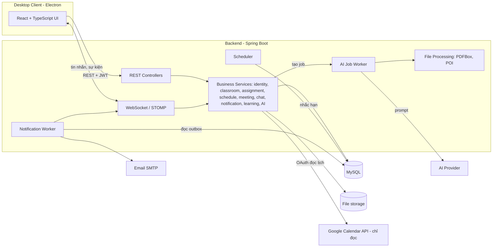

### 6.1 Phân lớp và module Backend

| Lớp | Trách nhiệm | Quy tắc |
| :--- | :--- | :--- |
| Controller | Nhận request, validate DTO, gọi service, trả response | Không chứa nghiệp vụ |
| Service | Quy tắc nghiệp vụ, kiểm tra quyền, ranh giới transaction | Không giữ transaction mở khi gọi AI/Google |
| Repository | Truy cập dữ liệu (Spring Data JPA) | DTO projection cho danh sách, chống N+1 |
| Entity, DTO, Mapper | Mô hình dữ liệu và dữ liệu vào/ra | Không trả Entity trực tiếp |
| Integration | Adapter AI Provider, Google, SMTP, lưu file | Đổi nhà cung cấp không ảnh hưởng service |

Module: `identity`, `classroom`, `assignment`, `schedule`, `meeting`, `chat`, `notification`, `learning` (course, material, quiz, flashcard, analytics), `ai`.

### 6.2 Cơ chế xuyên suốt

- **Job AI:** ghi `ai_job` (PENDING) rồi trả 202; worker lấy job, gọi AI ngoài transaction, ghi kết quả, đẩy sự kiện. Retry tối đa 2 lần với backoff; quá hạn thì FAILED với mã lỗi dễ hiểu.

- **Transactional outbox:** sự kiện thông báo ghi cùng transaction nghiệp vụ; worker gửi sau, có khóa duy nhất chống trùng.

- **Quyền:** kiểm tra ở service theo (vai trò, quan hệ lớp, chủ sở hữu); có kiểm thử quyền giữa các lớp.

- **Thời gian:** lưu UTC, kèm múi giờ sự kiện; hạn nộp và giờ làm bài do máy chủ quyết định.

- **Chống trùng:** unique constraint + `idempotency_key` + `version` (optimistic locking).

## 7. Sơ đồ Use Case

Ba sơ đồ theo nhóm chức năng. Đường nét đứt biểu diễn quan hệ include/extend giữa các use case.

### 7.1 Học tập cá nhân với AI (Phase 1 và 5)

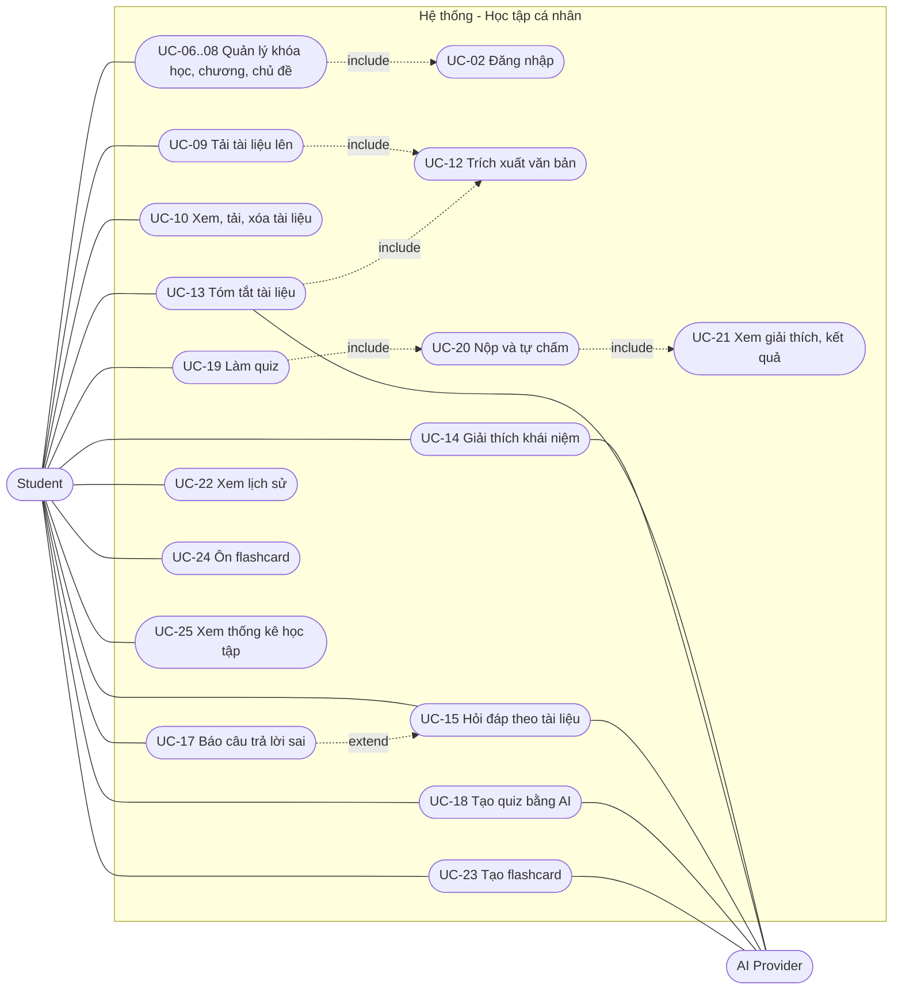

### 7.2 Lớp học, bài tập, quản trị (Phase 2)

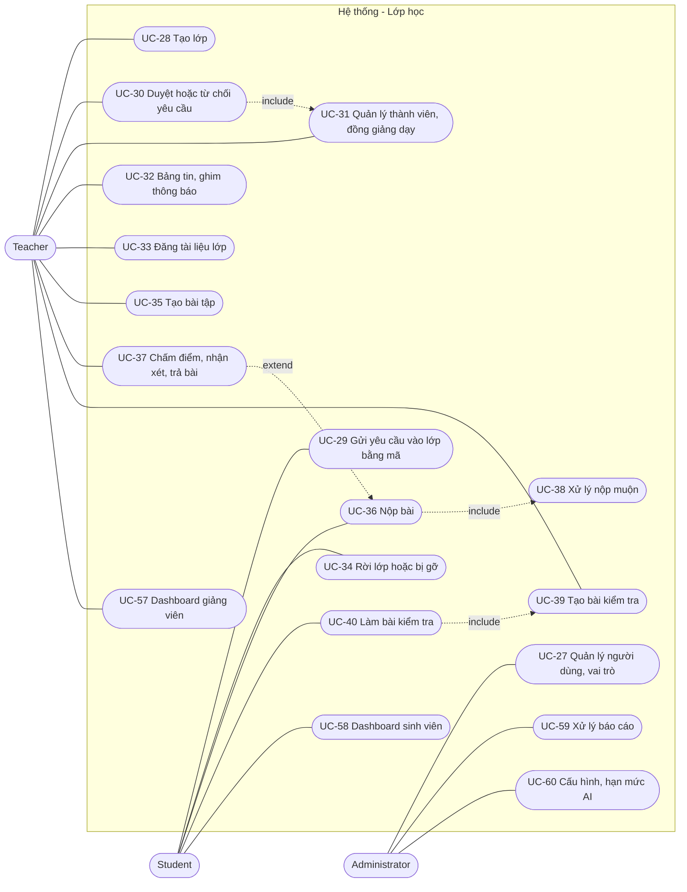

### 7.3 Lịch, kế hoạch, chat, thông báo (Phase 3 đến 5)

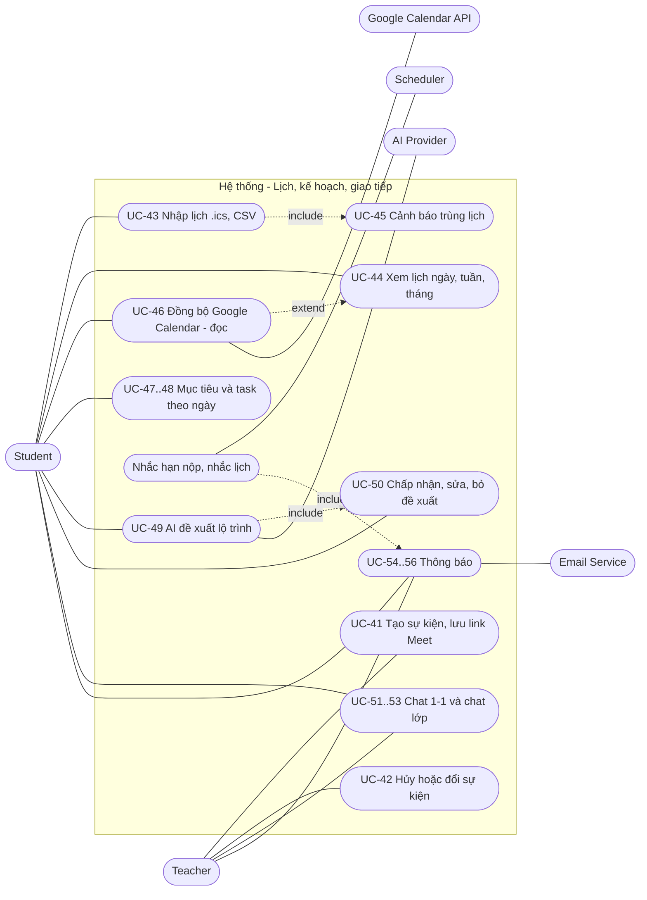

Lưu ý: UC-61 là use case hệ thống do Scheduler kích hoạt, không có actor người dùng.

## 8. Sơ đồ hoạt động (Activity Diagram)

Mỗi sơ đồ chia làn theo đối tượng thực hiện. Hình thoi là điểm rẽ nhánh.

### 8.1 Tải tài liệu và trích xuất văn bản (UC-09, UC-12)

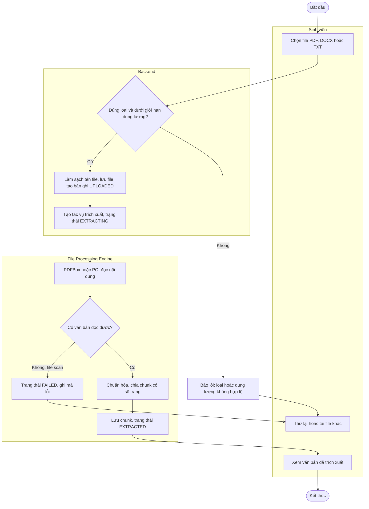

### 8.2 Tóm tắt tài liệu bằng AI (UC-13)

```mermaid
flowchart TD
  start(["Bắt đầu"]) --> sel
  subgraph SV["Sinh viên"]
    sel["Chọn tài liệu và độ dài: ngắn, vừa, chi tiết"]
    show["Xem bản tóm tắt, có thể báo sai"]
    wait["Thấy trạng thái đang xử lý, có thể hủy"]
  end
  subgraph BE["Backend"]
    chk{"Tài liệu đã EXTRACTED và thuộc người dùng?"}
    job["Tạo ai_job PENDING, trả 202"]
    long{"Tài liệu dài?"}
    chunk["Chia đoạn, tóm tắt từng đoạn rồi gộp"]
    one["Dựng prompt một lần"]
    call["Gọi AI Provider ngoài transaction"]
    okq{"Gọi thành công?"}
    rt{"Còn lượt thử lại?"}
    val{"Đầu ra hợp lệ?"}
    save["Lưu bản tóm tắt cùng model, phiên bản prompt, nguồn, thời điểm"]
    fl["Job FAILED, thông báo lỗi dễ hiểu"]
  end
  sel --> chk
  chk -- Không --> e1["Báo lỗi 422 hoặc 403"] --> fin(["Kết thúc"])
  chk -- Có --> job --> wait --> long
  long -- Có --> chunk --> call
  long -- Không --> one --> call
  call --> okq
  okq -- Không --> rt
  rt -- Có --> call
  rt -- Không --> fl --> fin
  okq -- Có --> val
  val -- Không --> rt
  val -- Có --> save --> show --> fin
```

### 8.3 Tạo quiz, làm bài và chấm điểm (UC-18 đến UC-22)

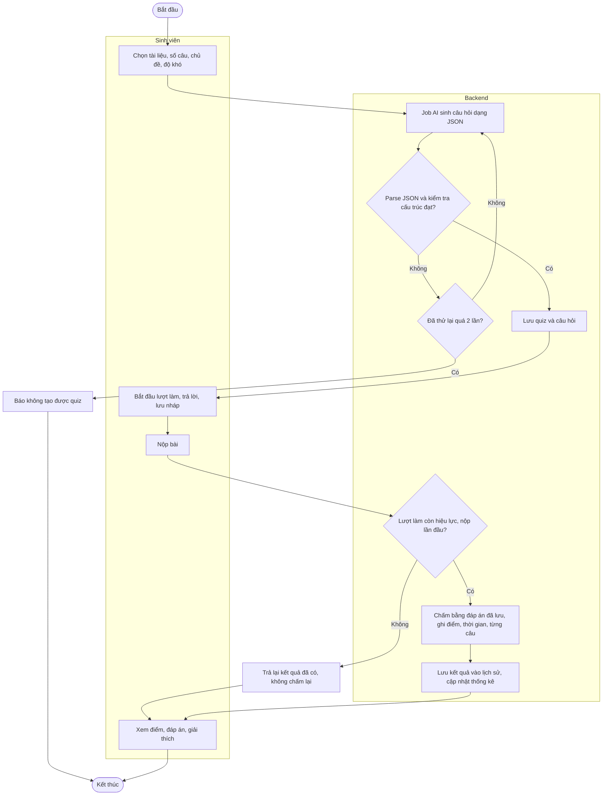

### 8.4 Tham gia lớp bằng mã (UC-29, UC-30, UC-34)

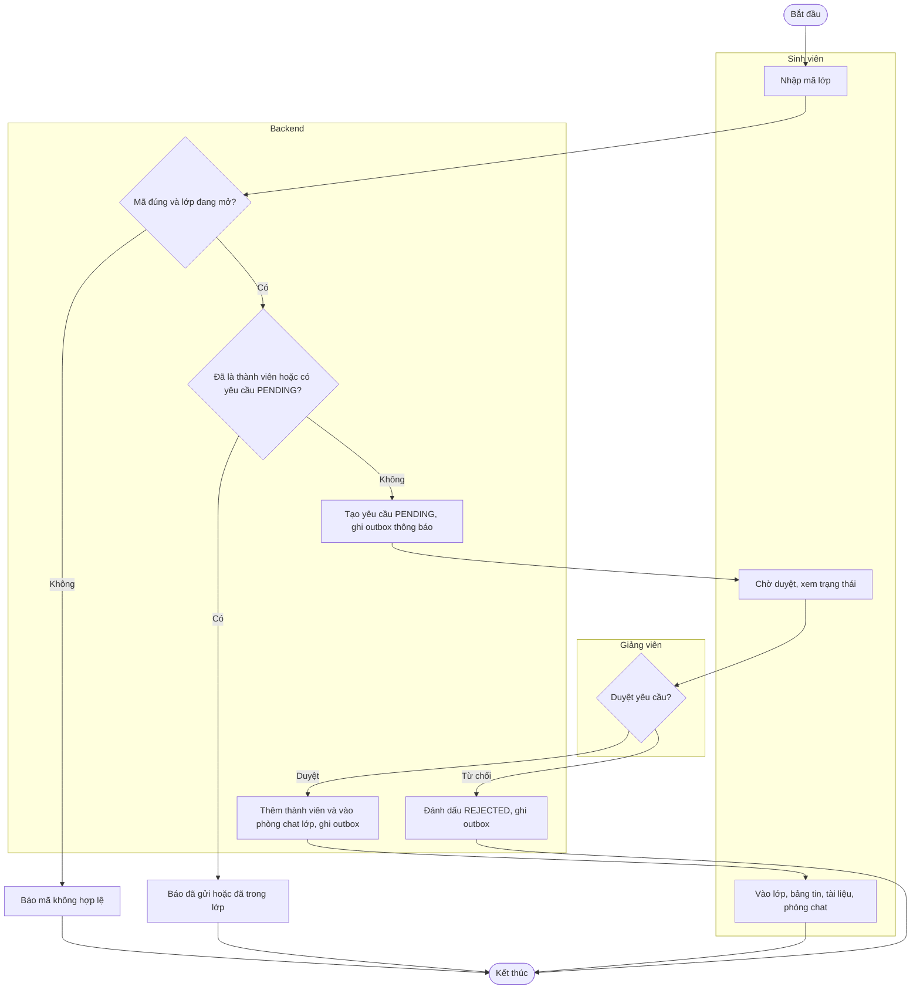

### 8.5 Nộp bài tập và chấm điểm (UC-36 đến UC-38)

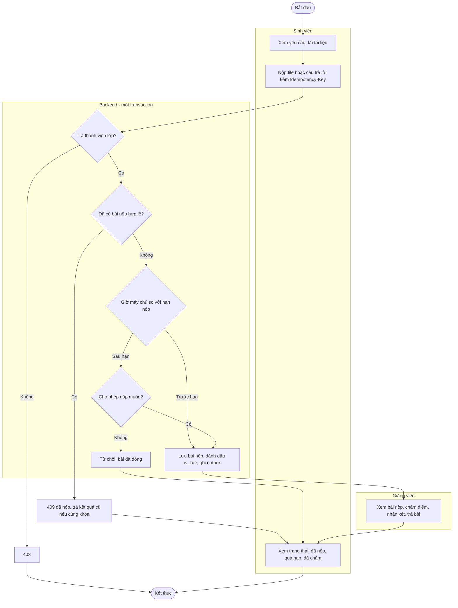

### 8.6 Nhập lịch từ .ics hoặc CSV (UC-43, UC-45)

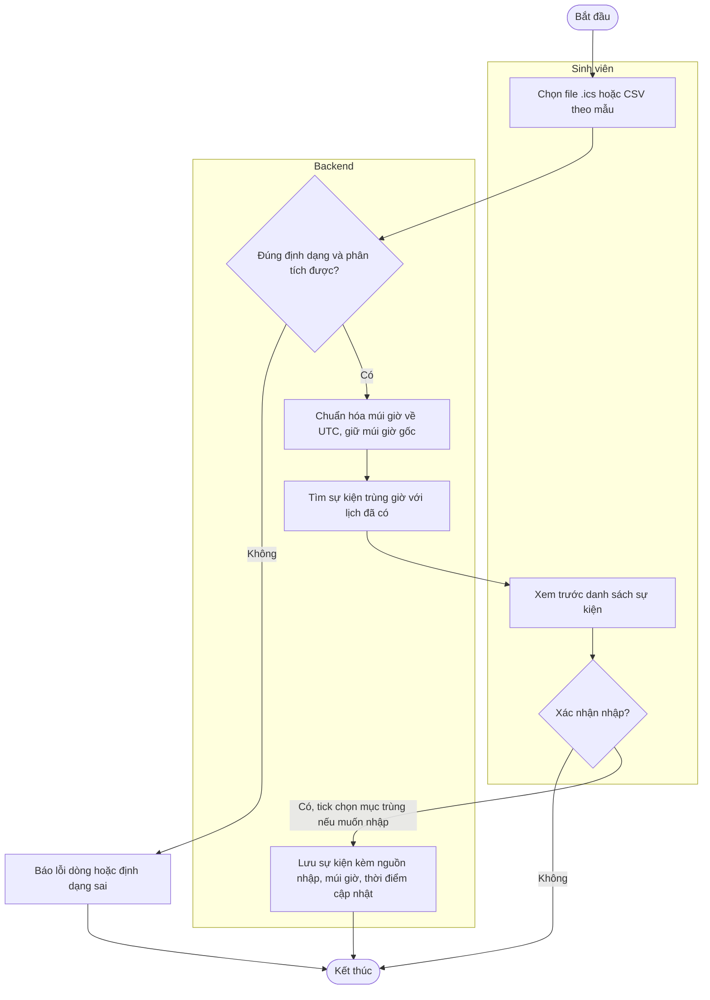

### 8.7 Gửi thông báo bằng outbox (FR-19)

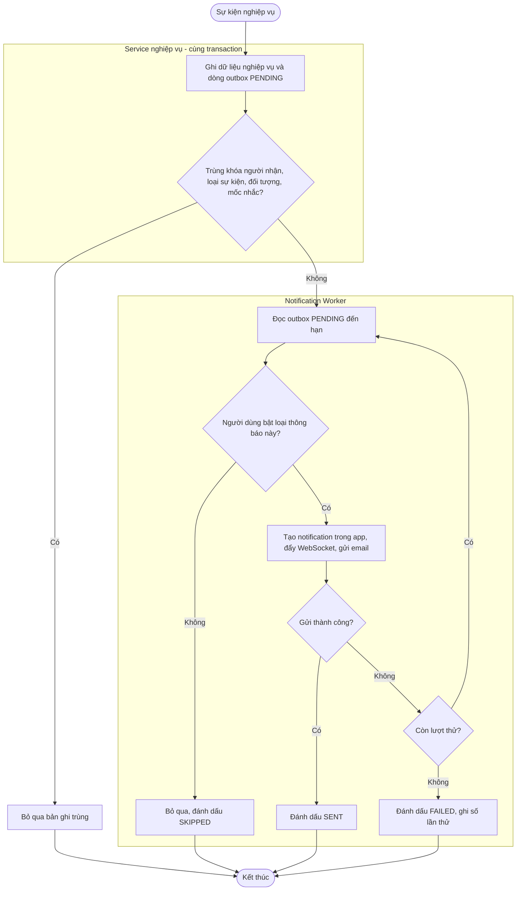

## 9. Sơ đồ tuần tự (Sequence Diagram)

### 9.1 Đăng nhập và làm mới token (UC-02)

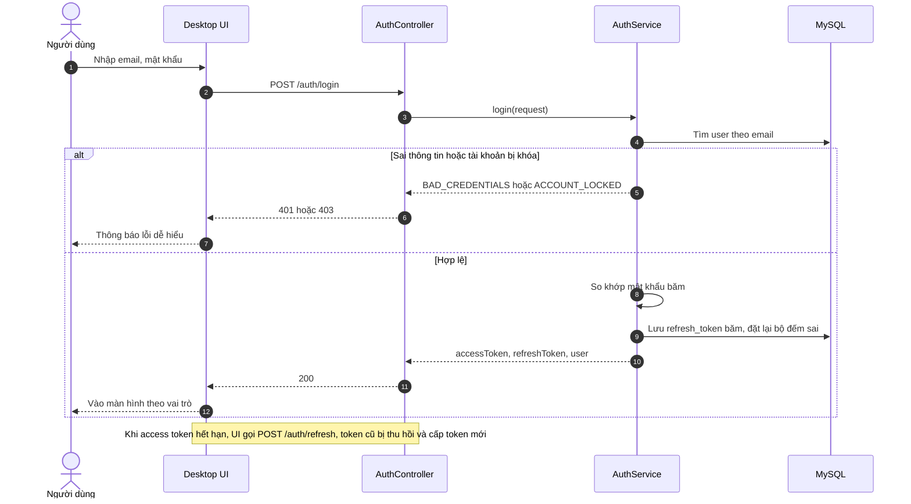

### 9.2 Tải tài liệu và trích xuất (UC-09, UC-12)

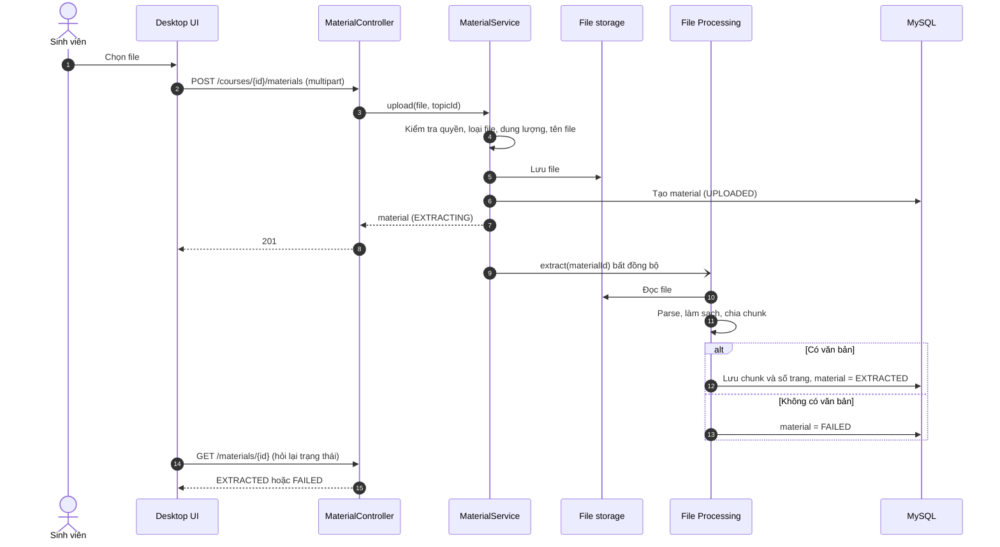

### 9.3 Tóm tắt tài liệu bất đồng bộ (UC-13)

```mermaid
sequenceDiagram
  autonumber
  actor U as Sinh viên
  participant UI as Desktop UI
  participant API as AiController
  participant SVC as AiService
  participant W as AI Job Worker
  participant AIP as AI Provider
  participant DB as MySQL
  U->>UI: Chọn tài liệu, độ dài
  UI->>API: POST /ai/summaries
  API->>SVC: createSummaryJob(request)
  SVC->>DB: Kiểm tra quyền, tạo ai_job PENDING
  API-->>UI: 202 jobId
  loop Cho đến khi xong
    UI->>API: GET /ai/jobs/{jobId}
    API-->>UI: PENDING hoặc RUNNING
  end
  W->>DB: Nhận job, đọc chunk (không giữ transaction khi gọi AI)
  W->>AIP: Prompt tóm tắt
  alt Lỗi hoặc timeout
    W->>W: Thử lại có backoff, tối đa 2 lần
    W->>DB: Hết lượt thì job FAILED
  else Thành công
    W->>W: Kiểm tra đầu ra
    W->>DB: Lưu ai_summary kèm model, prompt_version; job SUCCEEDED
    W-)UI: Sự kiện /user/queue/ai-jobs
  end
  UI->>API: GET /ai/summaries/{id}
  API-->>UI: Nội dung tóm tắt
  UI-->>U: Hiển thị
```

### 9.4 Hỏi đáp theo tài liệu có trích nguồn (UC-15)

```mermaid
sequenceDiagram
  autonumber
  actor U as Sinh viên
  participant UI as Desktop UI
  participant API as AiController
  participant R as Retriever
  participant AIP as AI Provider
  participant DB as MySQL
  U->>UI: Nhập câu hỏi, chọn tài liệu
  UI->>API: POST /ai/chats/{id}/messages
  API->>DB: Lưu câu hỏi, kiểm tra quyền tài liệu
  API->>R: Tìm đoạn liên quan (từ khóa; embedding ở Phase 5)
  R->>DB: Truy vấn chunk
  R-->>API: Top-k chunk kèm trang
  alt Không có đoạn đủ liên quan
    API->>DB: Lưu trả lời cố định, grounded = false
    API-->>UI: Tài liệu hiện tại chưa có thông tin để kết luận
  else Có ngữ cảnh
    API->>AIP: Prompt giới hạn ngữ cảnh, yêu cầu tách phần trong tài liệu và phần AI giải thích thêm
    AIP-->>API: Câu trả lời
    API->>DB: Lưu trả lời, nguồn (material, trang, chunk), model, prompt_version
    API-->>UI: Trả lời kèm nguồn
  end
  UI-->>U: Hiển thị, nút Báo câu trả lời sai
```

### 9.5 Nộp quiz và chấm điểm (UC-20)

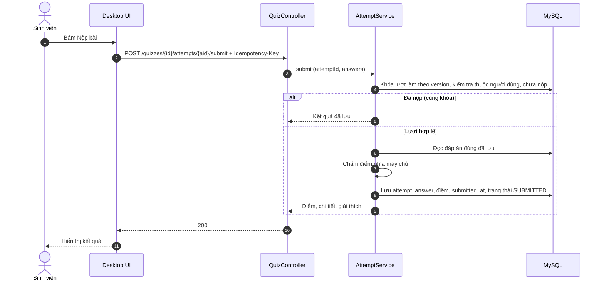

### 9.6 Tham gia lớp: gửi yêu cầu và duyệt (UC-29, UC-30)

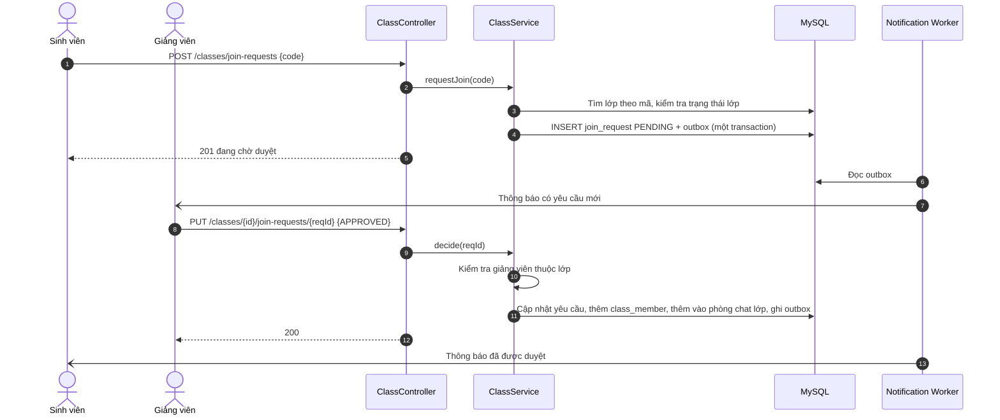

### 9.7 Nộp bài tập đúng hạn hoặc muộn (UC-36)

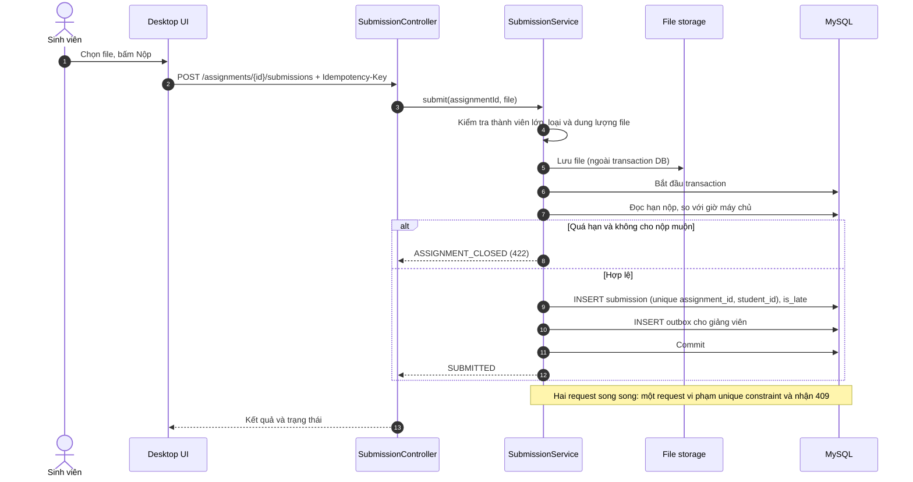

### 9.8 Gửi tin nhắn thời gian thực (UC-51, UC-52)

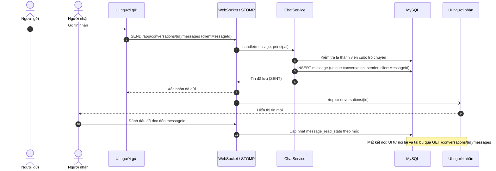

### 9.9 Đồng bộ lịch Google, chỉ đọc (UC-46)

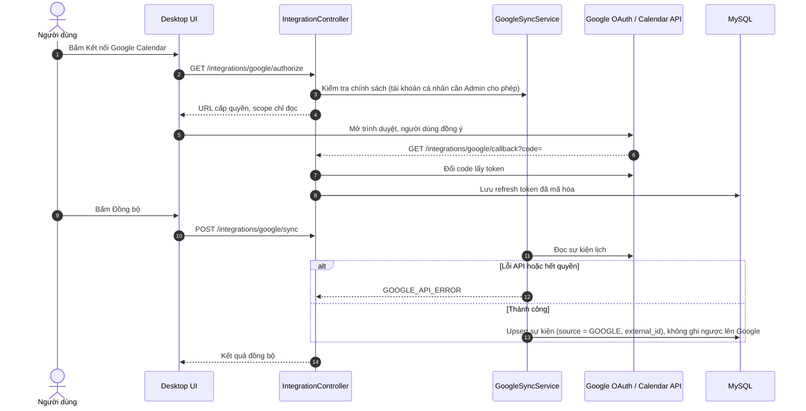

## 10. Thiết kế dữ liệu (ERD)

MySQL, khóa chính `id` kiểu BIGINT (hoặc UUID cho `ai_job`). Mọi bảng có `created_at`, `updated_at`; bảng có thể cập nhật đồng thời có `version`. Thời gian lưu UTC. ERD chia thành sáu nhóm; `user` xuất hiện ở nhiều nhóm làm điểm nối.

### 10.1 Định danh, khóa học, tài liệu

```mermaid
erDiagram
  USER ||--o{ REFRESH_TOKEN : has
  USER ||--o{ COURSE : owns
  COURSE ||--o{ CHAPTER : contains
  CHAPTER ||--o{ TOPIC : contains
  COURSE ||--o{ MATERIAL : holds
  TOPIC |o--o{ MATERIAL : classifies
  USER ||--o{ MATERIAL : uploads
  MATERIAL ||--o{ MATERIAL_CHUNK : split_into
  USER {
    bigint id PK
    string email UK
    string password_hash
    string full_name
    string role "STUDENT, TEACHER, ADMIN"
    string status "ACTIVE, LOCKED"
    string avatar_url
    int failed_login_count
    datetime locked_until
    int version
  }
  REFRESH_TOKEN {
    bigint id PK
    bigint user_id FK
    string token_hash UK
    datetime expires_at
    datetime revoked_at
  }
  COURSE {
    bigint id PK
    bigint owner_id FK
    string name
    string description
    int version
  }
  CHAPTER {
    bigint id PK
    bigint course_id FK
    string title
    int position
  }
  TOPIC {
    bigint id PK
    bigint chapter_id FK
    string title
    int position
  }
  MATERIAL {
    bigint id PK
    bigint course_id FK
    bigint topic_id FK
    bigint owner_id FK
    string file_name
    string stored_path
    string mime_type
    bigint size_bytes
    string category
    string status "UPLOADED, EXTRACTING, EXTRACTED, FAILED"
    int page_count
    string content_hash
  }
  MATERIAL_CHUNK {
    bigint id PK
    bigint material_id FK
    int chunk_index
    int page_from
    int page_to
    text content
    int token_count
  }
```

### 10.2 AI, quiz, flashcard

```mermaid
erDiagram
  USER ||--o{ AI_JOB : requests
  USER ||--o{ AI_CHAT : starts
  AI_CHAT ||--o{ AI_CHAT_MESSAGE : has
  AI_CHAT_MESSAGE ||--o{ AI_MESSAGE_SOURCE : cites
  MATERIAL_CHUNK ||--o{ AI_MESSAGE_SOURCE : referenced_by
  MATERIAL ||--o{ AI_SUMMARY : summarized_in
  USER ||--o{ AI_FEEDBACK : reports
  USER ||--o{ QUIZ : owns
  QUIZ ||--o{ QUESTION : has
  QUESTION ||--o{ QUESTION_OPTION : has
  QUIZ }o--o{ MATERIAL : built_from
  TOPIC |o--o{ QUESTION : tags
  QUIZ ||--o{ QUIZ_ATTEMPT : attempted_as
  USER ||--o{ QUIZ_ATTEMPT : takes
  QUIZ_ATTEMPT ||--o{ ATTEMPT_ANSWER : records
  QUESTION ||--o{ ATTEMPT_ANSWER : answered_in
  USER ||--o{ FLASHCARD_DECK : owns
  FLASHCARD_DECK ||--o{ FLASHCARD : has
  FLASHCARD ||--o{ FLASHCARD_REVIEW : reviewed_in
  AI_JOB {
    uuid id PK
    bigint user_id FK
    string type "SUMMARY, EXPLAIN, QUIZ, FLASHCARD, PLAN"
    string status "PENDING, RUNNING, SUCCEEDED, FAILED, CANCELLED"
    json input_json
    string result_type
    bigint result_id
    string error_code
    int attempts
    datetime finished_at
  }
  AI_SUMMARY {
    bigint id PK
    bigint material_id FK
    bigint user_id FK
    string length "SHORT, MEDIUM, DETAILED"
    text content
    string model
    string prompt_version
  }
  AI_CHAT {
    bigint id PK
    bigint user_id FK
    string title
  }
  AI_CHAT_MESSAGE {
    bigint id PK
    bigint chat_id FK
    string role "USER, ASSISTANT"
    text content
    boolean grounded
    text ai_added_note
    string model
    string prompt_version
  }
  AI_MESSAGE_SOURCE {
    bigint id PK
    bigint message_id FK
    bigint material_id FK
    bigint chunk_id FK
    int page
  }
  AI_FEEDBACK {
    bigint id PK
    bigint user_id FK
    string target_type
    bigint target_id
    string reason
    string status "OPEN, RESOLVED"
  }
  QUIZ {
    bigint id PK
    bigint owner_id FK
    bigint course_id FK
    string title
    string difficulty
    int question_count
    uuid source_job_id FK
    string model
    string prompt_version
  }
  QUESTION {
    bigint id PK
    bigint quiz_id FK
    bigint topic_id FK
    int position
    text content
    string type "SINGLE_CHOICE, MULTI_CHOICE"
    text explanation
    bigint source_chunk_id FK
  }
  QUESTION_OPTION {
    bigint id PK
    bigint question_id FK
    string label
    text content
    boolean is_correct
  }
  QUIZ_ATTEMPT {
    bigint id PK
    bigint quiz_id FK
    bigint user_id FK
    bigint test_id FK
    string status "IN_PROGRESS, SUBMITTED, EXPIRED"
    datetime started_at
    datetime deadline_at
    datetime submitted_at
    int duration_seconds
    decimal score
    decimal max_score
    string idempotency_key UK
    int version
  }
  ATTEMPT_ANSWER {
    bigint id PK
    bigint attempt_id FK
    bigint question_id FK
    json selected_option_ids
    boolean is_correct
  }
  FLASHCARD_DECK {
    bigint id PK
    bigint owner_id FK
    bigint course_id FK
    string title
  }
  FLASHCARD {
    bigint id PK
    bigint deck_id FK
    text front
    text back
    bigint source_chunk_id FK
  }
  FLASHCARD_REVIEW {
    bigint id PK
    bigint card_id FK
    bigint user_id FK
    string rating "FORGOT, HARD, OK, EASY"
    datetime next_review_at
  }
```

### 10.3 Lớp học, bài tập, bài kiểm tra

```mermaid
erDiagram
  USER ||--o{ CLASSROOM : owns
  CLASSROOM ||--o{ CLASS_MEMBER : has
  USER ||--o{ CLASS_MEMBER : joins_as
  CLASSROOM ||--o{ CLASS_JOIN_REQUEST : receives
  USER ||--o{ CLASS_JOIN_REQUEST : sends
  CLASSROOM ||--o{ CLASS_POST : shows
  CLASSROOM ||--o{ CLASS_MATERIAL : shares
  CLASSROOM ||--o{ ASSIGNMENT : gives
  ASSIGNMENT ||--o{ ASSIGNMENT_ATTACHMENT : attaches
  ASSIGNMENT ||--o{ SUBMISSION : receives
  USER ||--o{ SUBMISSION : submits
  SUBMISSION ||--o{ SUBMISSION_FILE : contains
  CLASSROOM ||--o{ CLASS_TEST : schedules
  QUIZ ||--o{ CLASS_TEST : used_by
  CLASS_TEST ||--o{ QUIZ_ATTEMPT : attempted_as
  CLASSROOM {
    bigint id PK
    string code UK
    string name
    text description
    string subject
    string avatar_url
    datetime start_at
    datetime end_at
    string status "OPEN, CLOSED, ARCHIVED"
    bigint owner_id FK
    int version
  }
  CLASS_MEMBER {
    bigint id PK
    bigint class_id FK
    bigint user_id FK
    string class_role "OWNER_TEACHER, CO_TEACHER, STUDENT"
    string status "ACTIVE, LEFT, REMOVED"
    datetime joined_at
  }
  CLASS_JOIN_REQUEST {
    bigint id PK
    bigint class_id FK
    bigint student_id FK
    string status "PENDING, APPROVED, REJECTED"
    bigint decided_by FK
    datetime decided_at
  }
  CLASS_POST {
    bigint id PK
    bigint class_id FK
    bigint author_id FK
    string title
    text content
    boolean pinned
  }
  CLASS_MATERIAL {
    bigint id PK
    bigint class_id FK
    bigint uploader_id FK
    string file_name
    string stored_path
    string mime_type
    bigint size_bytes
  }
  ASSIGNMENT {
    bigint id PK
    bigint class_id FK
    bigint creator_id FK
    string title
    text instructions
    decimal max_score
    datetime open_at
    datetime due_at
    boolean allow_late
    int max_submissions
    int version
  }
  ASSIGNMENT_ATTACHMENT {
    bigint id PK
    bigint assignment_id FK
    string file_name
    string stored_path
  }
  SUBMISSION {
    bigint id PK
    bigint assignment_id FK
    bigint student_id FK
    text text_answer
    string status "SUBMITTED, GRADED, RETURNED"
    boolean is_late
    datetime submitted_at
    decimal score
    text feedback
    bigint graded_by FK
    datetime graded_at
    string idempotency_key
    int version
  }
  SUBMISSION_FILE {
    bigint id PK
    bigint submission_id FK
    string file_name
    string stored_path
    bigint size_bytes
  }
  CLASS_TEST {
    bigint id PK
    bigint class_id FK
    bigint quiz_id FK
    string title
    datetime start_at
    datetime end_at
    int duration_minutes
    int max_attempts
    boolean shuffle_questions
  }
```

### 10.4 Lịch, tích hợp Google, mục tiêu và kế hoạch

```mermaid
erDiagram
  USER ||--o{ EVENT : creates
  CLASSROOM |o--o{ EVENT : hosts
  USER ||--o{ CALENDAR_IMPORT : imports
  CALENDAR_IMPORT |o--o{ EVENT : produces
  USER ||--o| EXTERNAL_ACCOUNT : links
  USER ||--o{ GOAL : sets
  GOAL ||--o{ TASK : splits_into
  USER ||--o{ TASK : owns
  USER ||--o{ STUDY_PLAN : receives
  STUDY_PLAN ||--o{ STUDY_PLAN_ITEM : proposes
  STUDY_PLAN_ITEM |o--o| TASK : accepted_as
  EVENT {
    bigint id PK
    bigint owner_id FK
    bigint class_id FK
    bigint import_id FK
    string type "CLASS, TEST, MEETING, PERSONAL"
    string title
    text description
    datetime start_at
    datetime end_at
    string timezone
    string status "UPCOMING, ONGOING, ENDED, CANCELLED"
    string meeting_url
    string source "MANUAL, ICS, CSV, GOOGLE"
    string external_id
    int version
  }
  CALENDAR_IMPORT {
    bigint id PK
    bigint user_id FK
    string source_type "ICS, CSV"
    string file_name
    string timezone
    string status "PREVIEW, CONFIRMED, CANCELLED"
  }
  EXTERNAL_ACCOUNT {
    bigint id PK
    bigint user_id FK
    string provider
    string scopes
    text refresh_token_encrypted
    datetime connected_at
    datetime last_synced_at
  }
  GOAL {
    bigint id PK
    bigint user_id FK
    string title
    string subject
    date due_date
    string priority "LOW, MEDIUM, HIGH"
    string status
    json free_time
  }
  TASK {
    bigint id PK
    bigint user_id FK
    bigint goal_id FK
    string title
    date task_date
    string priority
    string status "TODO, DONE, MISSED"
    datetime remind_at
  }
  STUDY_PLAN {
    bigint id PK
    bigint user_id FK
    uuid job_id FK
    string status "PROPOSED, PARTIAL, CLOSED"
    string rationale
    string model
    string prompt_version
  }
  STUDY_PLAN_ITEM {
    bigint id PK
    bigint plan_id FK
    string title
    datetime planned_start
    datetime planned_end
    string decision "PENDING, ACCEPTED, EDITED, REJECTED"
  }
```

### 10.5 Chat và thông báo

```mermaid
erDiagram
  CLASSROOM |o--o| CONVERSATION : has_room
  CONVERSATION ||--o{ CONVERSATION_MEMBER : has
  USER ||--o{ CONVERSATION_MEMBER : joins
  CONVERSATION ||--o{ MESSAGE : contains
  USER ||--o{ MESSAGE : sends
  CONVERSATION ||--o{ MESSAGE_READ_STATE : tracks
  USER ||--o{ MESSAGE_READ_STATE : owns
  MESSAGE ||--o{ ATTACHMENT : has
  USER ||--o{ NOTIFICATION : receives
  USER ||--o{ NOTIFICATION_SETTING : configures
  USER ||--o{ NOTIFICATION_OUTBOX : is_recipient_of
  CONVERSATION {
    bigint id PK
    string type "CLASSROOM, DIRECT"
    bigint class_id FK
    string direct_key UK
  }
  CONVERSATION_MEMBER {
    bigint id PK
    bigint conversation_id FK
    bigint user_id FK
    datetime joined_at
    datetime left_at
  }
  MESSAGE {
    bigint id PK
    bigint conversation_id FK
    bigint sender_id FK
    text content
    string status "SENT, DELIVERED"
    string client_message_id
    datetime created_at
  }
  MESSAGE_READ_STATE {
    bigint id PK
    bigint conversation_id FK
    bigint user_id FK
    bigint last_read_message_id
    datetime updated_at
  }
  ATTACHMENT {
    bigint id PK
    bigint message_id FK
    string file_name
    string stored_path
  }
  NOTIFICATION {
    bigint id PK
    bigint user_id FK
    string type
    string title
    string body
    string target_type
    bigint target_id
    datetime read_at
  }
  NOTIFICATION_SETTING {
    bigint id PK
    bigint user_id FK
    string type
    boolean in_app_enabled
    boolean email_enabled
  }
  NOTIFICATION_OUTBOX {
    bigint id PK
    bigint recipient_id FK
    string event_type
    string object_type
    bigint object_id
    string reminder_key
    string channel "IN_APP, EMAIL"
    json payload
    string status "PENDING, SENT, FAILED, SKIPPED"
    int attempts
    datetime next_try_at
    datetime sent_at
  }
```

### 10.6 Quản trị và hạ tầng

```mermaid
erDiagram
  USER ||--o{ REPORT : files
  USER ||--o{ AUDIT_LOG : acts_in
  USER ||--o{ IDEMPOTENCY_KEY : sends
  REPORT {
    bigint id PK
    bigint reporter_id FK
    string type
    string target_type
    bigint target_id
    text detail
    string status "OPEN, RESOLVED"
    bigint handled_by FK
  }
  SYSTEM_SETTING {
    string key PK
    string value
    bigint updated_by FK
  }
  AUDIT_LOG {
    bigint id PK
    bigint user_id FK
    string action
    string object_type
    bigint object_id
    datetime created_at
  }
  IDEMPOTENCY_KEY {
    bigint id PK
    bigint user_id FK
    string idempotency_key
    string endpoint
    string response_hash
    datetime expires_at
  }
```

### 10.7 Ràng buộc và chỉ mục quan trọng

| Bảng | Ràng buộc duy nhất / chỉ mục | Mục đích |
| :--- | :--- | :--- |
| `user` | UNIQUE ( `email` ) | Không trùng tài khoản |
| `classroom` | UNIQUE ( `code` ) | Mã lớp duy nhất |
| `class_member` | UNIQUE ( `class_id` , `user_id` ) | Một người một vai trong lớp |
| `class_join_request` | UNIQUE ( `class_id` , `student_id` ) với trạng thái PENDING | Không gửi lặp yêu cầu |
| `submission` | UNIQUE ( `assignment_id` , `student_id` ) | Một lượt nộp hợp lệ (D-02); mở lại nộp thì cập nhật cùng bản ghi |
| `quiz_attempt` | UNIQUE ( `idempotency_key` ); INDEX ( `quiz_id` , `user_id` , `submitted_at` ) | Chống nộp lặp, tra lịch sử |
| `message` | UNIQUE ( `conversation_id` , `sender_id` , `client_message_id` ); INDEX ( `conversation_id` , `id` ) | Chống gửi lặp, phân trang cursor |
| `message_read_state` | UNIQUE ( `conversation_id` , `user_id` ) | Một mốc đọc cho mỗi người |
| `conversation` | UNIQUE ( `direct_key` ) | Một chat 1-1 cho mỗi cặp người dùng |
| `notification_outbox` | UNIQUE ( `recipient_id` , `event_type` , `object_id` , `reminder_key` , `channel` ); INDEX ( `status` , `next_try_at` ) | Chống thông báo trùng, worker quét hàng đợi |
| `notification` | INDEX ( `user_id` , `read_at` , `id` ) | Đếm chưa đọc, phân trang |
| `material_chunk` | UNIQUE ( `material_id` , `chunk_index` ) | Thứ tự đoạn |
| `event` | INDEX ( `owner_id` , `start_at` ); UNIQUE ( `owner_id` , `source` , `external_id` ) | Xem lịch theo khoảng, đồng bộ Google không nhân đôi |
| `ai_job` | INDEX ( `status` , `created_at` ); INDEX ( `user_id` , `created_at` ) | Worker lấy job, liệt kê job |

Quy ước xóa: khóa học, tài liệu và quiz dùng xóa mềm (`deleted_at`) để giữ lịch sử điểm; thành viên rời lớp đổi `status` chứ không xóa dòng, để giữ bài nộp và tin nhắn theo chính sách lưu trữ.

## 11. Ma trận truy vết

| FR | Module | Nhóm API | Sơ đồ liên quan | Bảng chính |
| :--- | :--- | :--- | :--- | :--- |
| FR-01 | identity | 5.1 | 9.1 | `user` , `refresh_token` |
| FR-02 | learning | 5.2 | 7.1 | `course` , `chapter` , `topic` |
| FR-03 | learning | 5.3 | 8.1, 9.2 | `material` , `material_chunk` |
| FR-04 | ai | 5.4 | 8.2, 9.3 | `ai_job` , `ai_summary` |
| FR-05 | ai | 5.4 | 9.4 | `ai_chat` , `ai_chat_message` , `ai_message_source` , `ai_feedback` |
| FR-06, FR-07 | ai, learning | 5.4, 5.5 | 8.3, 9.5 | `quiz` , `question` , `question_option` , `quiz_attempt` , `attempt_answer` |
| FR-08 | learning | 5.5 | 7.1 | `flashcard_deck` , `flashcard` , `flashcard_review` |
| FR-10, FR-21 | learning | 5.6 | 7.2 | Tổng hợp từ `quiz_attempt` , `attempt_answer` , `task` |
| FR-11 | identity | 5.1, 5.11 | 7.2 | `user` , `class_member` |
| FR-12 | classroom | 5.7 | 8.4, 9.6 | `classroom` , `class_member` , `class_join_request` , `class_post` , `class_material` |
| FR-13 | assignment | 5.8 | 8.5, 9.7 | `assignment` , `submission` , `submission_file` |
| FR-14 | assignment | 5.8 | 7.2 | `class_test` , `quiz_attempt` |
| FR-15, FR-16 | schedule, meeting | 5.9 | 8.6, 9.9 | `event` , `calendar_import` , `external_account` |
| FR-17 | schedule, ai | 5.9 | 7.3 | `goal` , `task` , `study_plan` , `study_plan_item` |
| FR-18 | chat | 5.10 | 9.8 | `conversation` , `message` , `message_read_state` |
| FR-19 | notification | 5.10 | 8.7 | `notification` , `notification_outbox` , `notification_setting` |
| FR-20 | assignment | 5.6 | 7.2 | Tổng hợp từ `submission` , `quiz_attempt` |

Các sơ đồ ở mục 7 đến 10 dùng cú pháp Mermaid: có thể sửa trực tiếp trong khối mã và dán vào công cụ vẽ khác khi cần.
